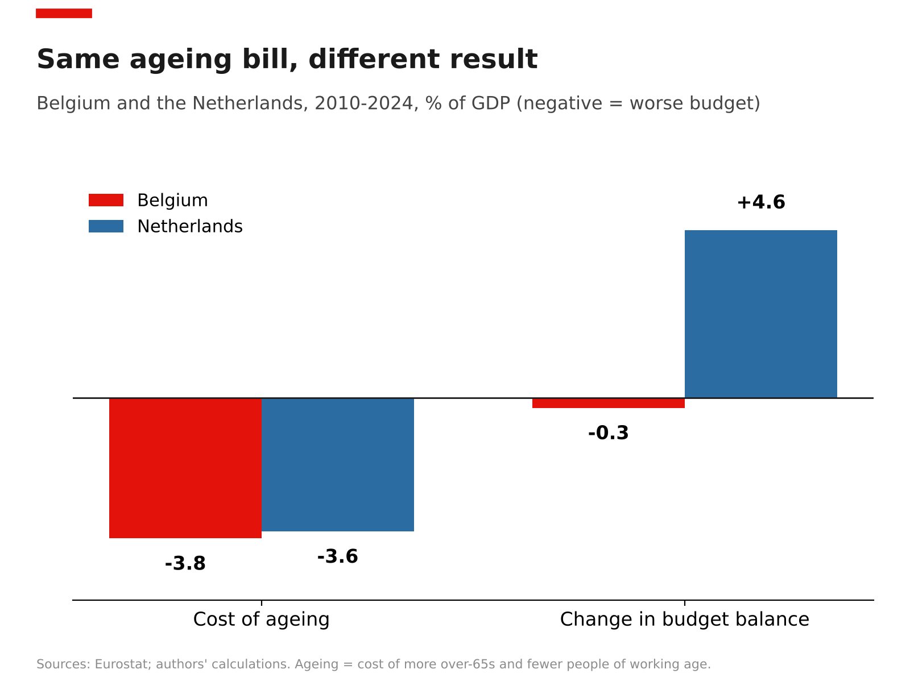
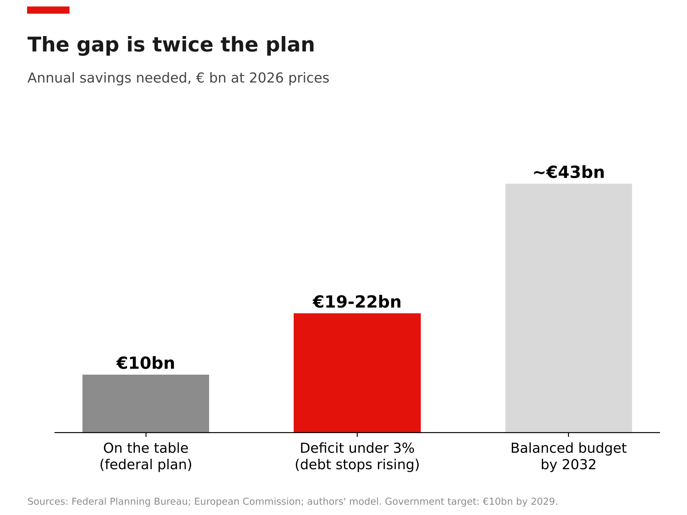
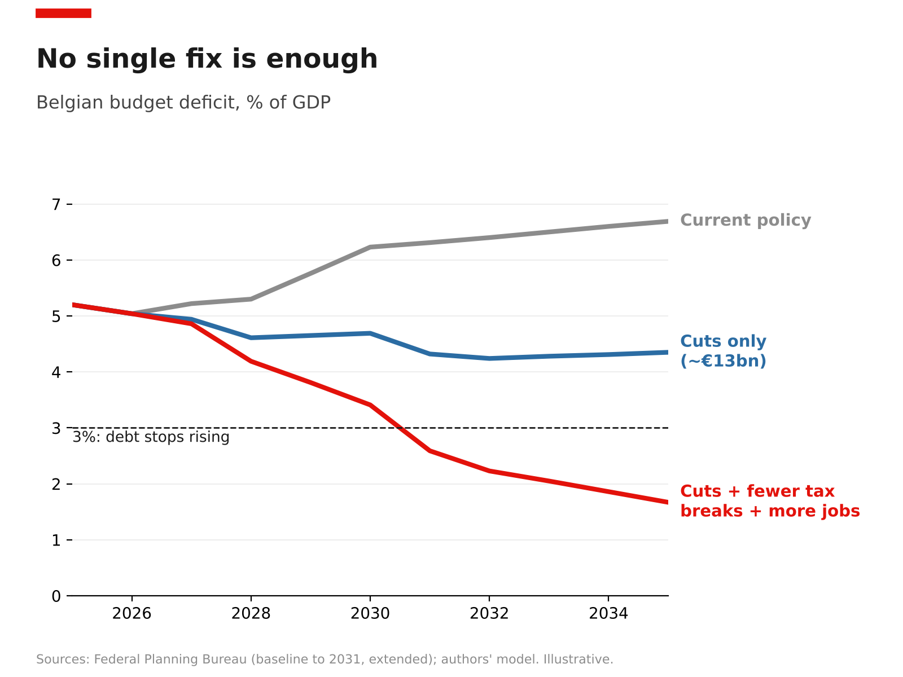
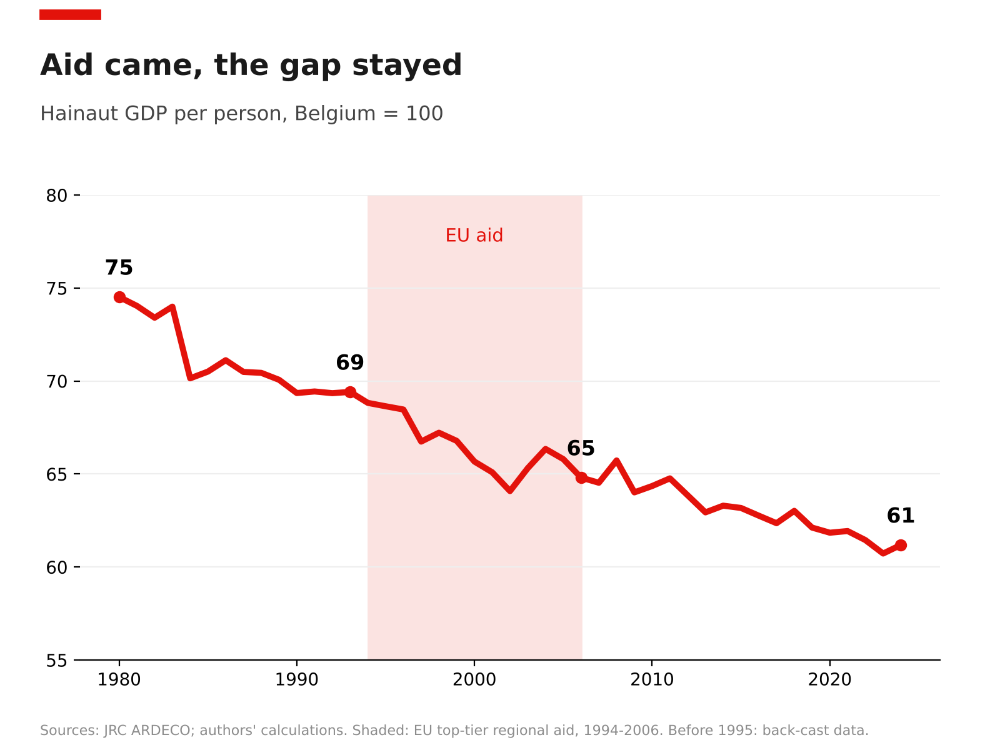

# Belgium's budget row is about the wrong number

*The government is fighting over €10bn. The gap is twice that, and ageing does not explain why Belgium fell behind its neighbours.*

On November 2nd Bart De Wever, Belgium's prime minister, offered his resignation after his five-party coalition failed to agree a budget. King Philippe refused it on November 6th and sent everyone back to the table. Mr De Wever reports to the palace again on Monday, November 16th. 2027 will start on a stopgap budget.

The row is about how to find €10bn of savings by 2029. The more useful question is whether €10bn is the right number. It is not.

**Why it matters**
- Belgium runs a deficit of about 5% of GDP and public debt of about 108%, among the highest in the euro area.
- On current policy both keep rising. The deficit heads for 6-7% and debt for 130% by the mid-2030s, on the Federal Planning Bureau's projections extended by a few years.
- Interest costs, which fell from about 4% of GDP in 2009 to about 1.6% in 2022, are climbing again: 2.2% in 2024, and 2.7% forecast for 2027 (AMECO).

## Ageing has an alibi

Ask a Belgian politician why the books do not balance and you will hear about ageing. It is real. On our reckoning from Eurostat data, more pensioners and fewer people of working age have cost about 3.8% of GDP since 2010, and the bill keeps growing.

But it does not explain why Belgium lags. The Netherlands faced almost exactly the same bill, about 3.6% of GDP. Over the same years the Dutch went from a deficit of 5% to near balance, while Belgium's deficit was a little worse at the end than at the start.



What differed was domestic and dull:
- **The Dutch took a bigger slice of wages in tax and contributions** (up 1.5 points of GDP between 2010 and 2024). Belgium's slice ended where it started.
- **The Dutch squeezed spending per pensioner and per benefit claimant hard in 2010-13.** Measured from 2012 onwards, the gap with Belgium shrinks to between 0.6 and 1.2 points of GDP, depending on the benchmark. The Dutch advantage was banked in a few unpopular years, not built from a better model.
- **Since 2019 Belgium's take from consumption taxes has slipped** by about 1.5 points of GDP. The energy-crisis cuts to VAT and excise appear to explain much of it.

Both countries, like Germany, also got a windfall from falling interest rates, worth about 1.4% of GDP to Belgium. Belgium spent its share, and the windfall is now running in reverse.

**Yes, but:** much of the rise in spending per person was not chosen by this decade's politicians. Benefits are tied to prices, pensions are partly linked to wages, and the health budget has a built-in growth norm. These are old decisions running on autopilot. They still count.

## The number nobody wants to say

Getting the deficit under 3% of GDP, roughly the point at which the debt ratio stops climbing, needs measures worth about 3-3.5% of GDP. That is €19bn-22bn a year in today's money, about twice what is on the table. A balanced budget by 2032 would take about €43bn, which is not realistic.



We modelled the options:
- **Cuts alone,** of about €13bn, leave the deficit at around 4% of GDP.
- **Growth alone** leaves it at around 5%, even with 80% of working-age adults in jobs, up from 73% today. Faster growth helps less than hoped, partly because the official forecast already assumes employment rising to about 75% by 2031.
- **Only a combination gets under 3%, around 2031 in our central case:** spending cuts, a trim of the country's generous tax breaks (company cars, payroll-tax exemptions, reduced VAT rates) and a serious push on jobs. That path also leaves debt falling, to about 100-105% of GDP by 2035.



The model is deliberately simple, and the risks lean the wrong way. Defence spending is not in the baseline: moving towards NATO's new target could add up to 1.5% of GDP. With faster ageing or interest costs, even the combination only just scrapes under 3%. No path we tested meets the government's goal of 3% by 2029.

## Subsidies are not a growth strategy

A favourite way to square the circle is to argue that public money pays for itself by spurring growth. Belgium has tested this at scale. It spends about €25bn a year, over 4% of GDP, supporting business, according to the National Bank.

The evidence is mixed:
- **Support for research works on its own terms.** The payroll-tax break for researchers raises private research spending.
- **Much of the rest shows little.** Cuts in employer contributions for first hires cost over €100k per extra job, the National Bank finds. The €2bn exemption for night and shift work comes with no evidence that it creates jobs.
- **Regional aid has not closed the gap.** Hainaut received the EU's top tier of regional aid from 1994 to 2006. Its income per person slid from 69% of the Belgian average when the money started to 65% when it stopped, and 61% today. Nobody can say how much worse it would have been without the money, but a large effect is hard to square with the record.



The best defence of these subsidies is that they hand back part of Belgium's heavy tax on labour; the OECD puts the tax wedge on an average wage at 52.5%. That is true. In our view it also points to a better design: one lower rate for everyone, instead of refunds exemption by exemption.

## What to watch

- **Monday's audience at the palace,** and whether the €10bn becomes a floor rather than a ceiling.
- **The European Commission's autumn forecast,** expected later this month, which will put an outside number on the gap.
- **Whether the regions and language communities,** which spend much of the money, are asked to share the effort. The federal level alone cannot get to 3%.

Belgium's ageing problem is the same one its neighbours have. What sets it apart is a habit: spending what growth and cheap money provided, then taxing work so heavily that it has to subsidise it back. The Dutch broke that habit in a few hard years. Belgium can too, but not for €10bn.

---

*Method and sources: Eurostat government finance statistics (COFOG) and national accounts; European Commission AMECO; Federal Planning Bureau medium-term outlook 2026-31; National Bank of Belgium; OECD Taxing Wages; JRC ARDECO regional data; Becker, Egger and von Ehrlich on EU regional funds. The split of the deficit into causes is an exact accounting identity, but results shift with the start year chosen; the 2026-35 paths are illustrative. Full method, code and data: `2026-11-belgium-deficit/` in this repository.*

---

## Rerun this

```
pip install -r requirements.txt
python 2026-11-belgium-deficit/run.py
```

This rebuilds every number and chart in this article from cached official data. Every figure traces to a file in `outputs/`:
the ageing and balance numbers to `theme_bridge.csv`, the start- and end-year ranges to `theme_bridge_robustness.csv`,
the deficit and debt paths to `scenarios_2026_2035.csv`, and the euro sizes to `what_it_takes.csv`.
Limits: results move with the start and end years, "spending per beneficiary" includes automatic drift, and the 2026-35 paths are illustrative.
See [README.md](README.md). Found a mistake? Open an issue with the "Something's wrong" form.
