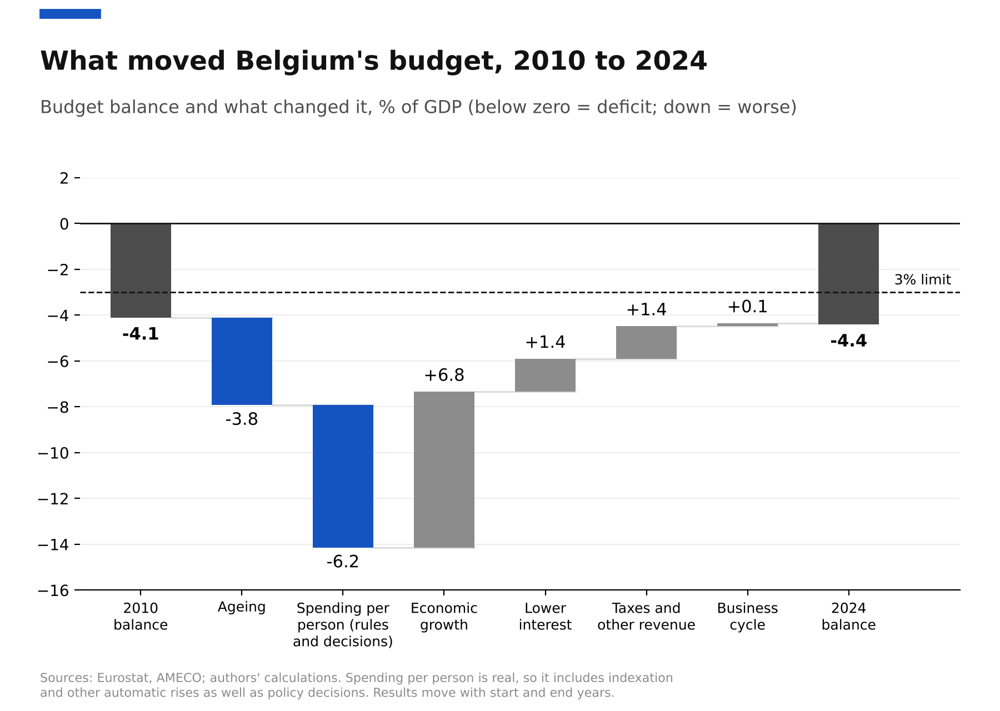

# Europe's budget crises are reruns

*Belgium's prime minister offered to resign over a budget this month, and France's lower house voted down half of one. Belgium's deficit has been above the EU's 3% limit in 12 of the past 17 years; France's in 15.*

On 2 November Belgium's prime minister offered to resign because his five-party coalition could not agree a budget. King Philippe refused and sent the parties back to the table. Two days later, in Paris, the National Assembly rejected the revenue half of France's 2027 budget at its first reading, by 458 votes to none.

Neither country is new to deadlock. Belgium went through it from 2018 to 2020: about 650 days with only a caretaker or minority government, after a coalition split over migration rather than money. Another 239 days followed the 2024 election. France has had five prime ministers since May 2022, and two of their governments fell over budgets. Its 2026 budget passed after the government agreed to suspend the 2023 pension reform, and the 2027 bill would cap inflation rises on all but the smallest pensions.

The money problem is older than the politics. Belgium's deficit has been above the 3% limit in 12 of the past 17 years, nearly three years in four. France's has been above it in 15; it got under only in 2018 and 2019. They have company: in 2025, 10 of the EU's 27 members were above the limit, and five, Belgium and France among them, carried debt above 100% of GDP. We take Belgium as the example; we did not analyse France's budget.

Our shorthand for each Belgian budget is a square peg in a round hole. Some spending rises by law: benefits follow prices, and more pensioners draw more pensions. Since 2010 spending has ranged from 52% to 56% of GDP, outside Covid in 2020, and revenue from 49% to 53%. In 2025 Belgium's government spent 54% of GDP, against 49% for the EU as a whole.

Belgium's one spell under 3%, from 2015 to 2019, came after a nine-year squeeze from a deficit of about 4% of GDP in 2010. Covid ended it in 2020, and the deficit has not come back below 3% since. In 2025 it was 5.2%. So is this a run of bad luck, or something built into the budget? Three questions help answer it:

- What pushes the deficit up when nobody votes for it?
- How big is the gap this round, and does the plan close it?
- Has anyone with the same pressures done better?

## What pushes the deficit up

Our breakdown of Eurostat and European Commission data shows what moved Belgium's balance between 2010 and 2024. Ageing took 3.8 points of GDP off it: more pensioners, and fewer people of working age to pay for them. Spending per person rose faster than prices and took another 6.2 points. That covers rules written into law, such as benefits that follow prices and a health budget with a growth norm. It also covers past decisions. Our split cannot separate the two.

Growth in jobs and productivity gave back 6.8 points. The 6.2 depends on the yardstick: measured against incomes rather than prices, spending per person grew a little more slowly than the economy and added about 2 points. In the Netherlands it added about 7. Cheaper debt gave Belgium 1.4 points, and taxes and other revenue another 1.4, as lower consumption taxes were more than offset by other revenue. The net result: a deficit of 4.4% of GDP in 2024, close to where it was in 2010. The help from interest has turned. Belgium's interest bill fell from 3.6% of GDP in 2010 to 1.6% in 2022, and the Commission forecasts 2.7% for 2027. Defence is the next line: moving to NATO's 3.5% target could add up to 1.5% of GDP, on our estimate.

## The size of this round

The government's target is savings of about €10bn by 2029. Sources do not say whether that is per year or in total. Our model, built on the Federal Planning Bureau's outlook, says a deficit under 3% of GDP takes €19bn a year by 2029, or €22bn a year by 2031. If the €10bn is an annual amount, it covers about half.

If policy does not change, the deficit drifts to about 6.7% of GDP by 2035, and debt climbs from 108% to about 132% of GDP. The years after 2031 rest on our own assumption about spending growth, so treat them as a direction, not a forecast.

## The Dutch path

The Netherlands faced almost the same ageing bill, 3.6 points of GDP, and kept revenue roughly flat at about 44% of GDP. Yet it cut spending from 49% of GDP in 2010 to 42% in 2019; it is 45% today. Its deficit was above 3% in only five of the past 17 years. Real government pension spending per person aged 65 and over fell in the Netherlands and rose in Belgium. Part of that may reflect a rising Dutch retirement age, and Dutch occupational pensions sit outside government, so this is not total pension income. Germany's spending effect was larger than Belgium's, so the comparison holds for the Netherlands only.

Indexation has a purpose. It shields pensioners and low earners from inflation. Our split does not isolate its cost, and does not value what it protects.

## What to watch

On Monday the prime minister reports to the King on the talks. Three questions follow any deal:

- Does it change any rule that sets spending after 2029, or only the totals before it?
- How is the €10bn split between cuts and new revenue, and is it per year or in total?
- What will the EU's fiscal rules ask of Belgium, France and the eight other countries above 3%?

---

**In numbers**
- **12 of 17**: years since 2009 in which Belgium's deficit was above 3% of GDP; France 15, the Netherlands 5.
- **3.8 points of GDP**: what ageing took off Belgium's balance from 2010 to 2024; 3.6 in the Netherlands.
- **54% vs 49%**: government spending as a share of GDP, Belgium against the EU, 2025.
- **€19bn a year by 2029, €22bn by 2031**: what a 3% deficit takes, against a €10bn target of unclear basis.

**Check our work.** Data and code: https://github.com/europeaudited/analysis/tree/main/2026-11-belgium-deficit. We split the change in the balance since 2010 into its parts and project to 2035: official forecasts to 2031, our assumptions after. Spending, revenue and deficits are from Eurostat. Political timelines are from Reuters, Euronews, VRT and The Brussels Times. Limits: one simple model; defence is not in the baseline; figures after 2025 are forecasts or our assumptions.

*Produced with AI agents, checked by a human editor. Found an error? [Open a ticket](https://github.com/europeaudited/analysis/issues/new/choose) and we will correct it in public.*
