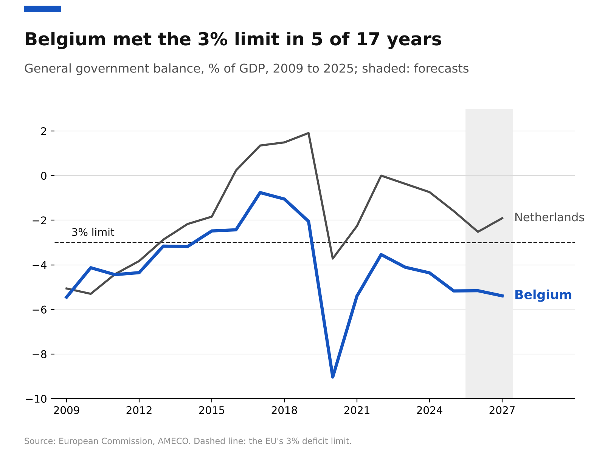
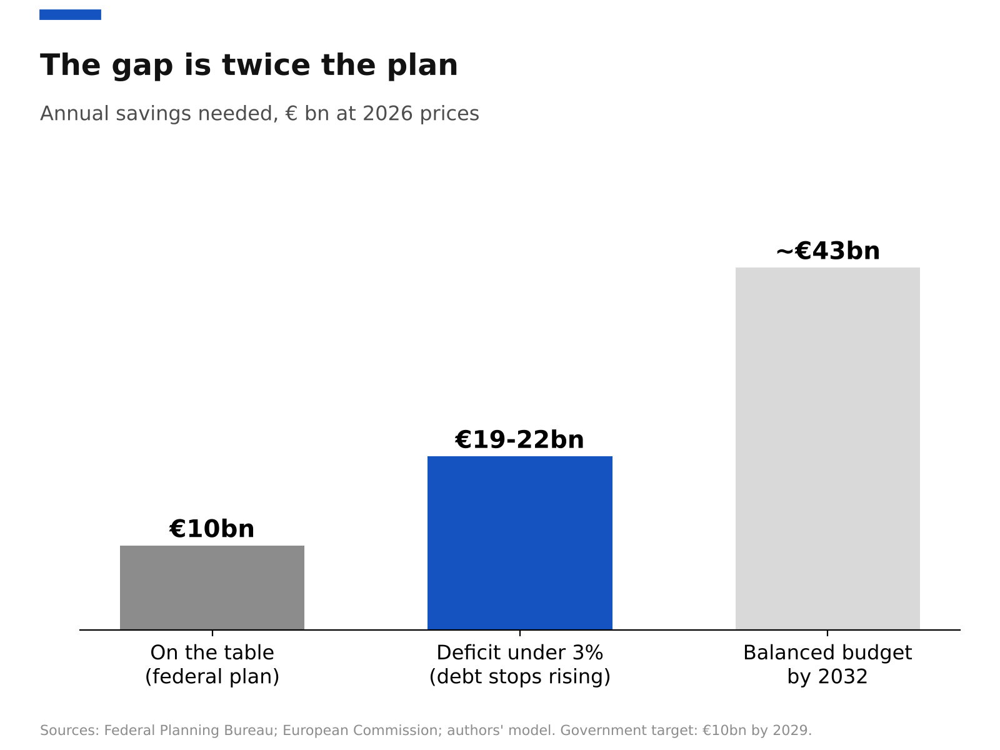

# Europe's budget crises are reruns

*Belgium and France are in budget fights in the same month. Belgium's deficit has been above the EU's 3% limit in 12 of the past 17 years.*

On Monday Belgium's prime minister reports to the King on the budget talks. On 2 November he offered to resign after his five-party coalition failed to agree a budget. King Philippe refused on 6 November and sent everyone back to the table. In Paris, the National Assembly threw out the revenue part of France's 2027 budget on 4 November, by 458 votes to none. France passed its last two budgets under article 49.3 of its constitution, which skips a final vote.

Two of the euro area's most indebted governments are having the same row in the same month. In Belgium it is not a new row. The country has been under the EU's 3% deficit limit in only five of the past 17 years, from 2015 to 2019. It got there after a long squeeze that took the deficit from about 4% of GDP in 2010 to 2% in 2019. It did not stay. Covid pushed the deficit to 9% of GDP in 2020, and it has not come back below 3% since.

So is this a run of bad luck, or does the budget keep rising on its own? Our numbers can answer part of that.

## What is already in the budget

Start with what no coalition negotiates each year. Since 2010 ageing has taken 3.8 points of GDP off Belgium's budget balance, on our breakdown of European Commission and Eurostat data. There are more pensioners and fewer people of working age to pay for them. Benefits rise with prices by law, pensions partly track wages, and the health budget has a growth norm written into it. Our split cannot separate these automatic rules from past decisions, so we report them together.

Interest helped for a decade. Belgium's interest bill fell from 3.6% of GDP in 2010 to 2.2% in 2024, worth about 1.4 points of GDP to the balance. It has turned. It was 1.6% in 2022, and the Commission forecasts 2.7% for 2027. Defence is the next line. Moving to NATO's 3.5% target could add up to 1.5% of GDP, on our estimate. Our baseline does not include it.

## The size of this round

The government's target is savings of about €10bn by 2029. Sources do not say whether that is per year or in total. Our model is built on the Federal Planning Bureau's outlook. It says a deficit under 3% of GDP takes €19bn a year by 2029, or €22bn a year by 2031. That is roughly where the debt ratio stops rising. If the €10bn is an annual amount, it covers about half.

If policy does not change, the deficit, 5.2% of GDP in 2025, drifts to about 6.7% by 2035, and debt climbs from 108% to about 132% of GDP. The years after 2031 rest on our own assumption about spending growth, so treat them as a direction, not a forecast. France had a deficit of 5.1% of GDP in 2025 and debt of about 116% (Eurostat). We did not analyse its budget.

## The Netherlands: same ageing bill, different result

The Netherlands is the closest comparison. It faced almost the same ageing bill, 3.6 points of GDP. Its deficit still went from 5% in 2010 to 0.7% in 2024. Over those years, real government pension spending per person aged 65 and over fell in the Netherlands and rose in Belgium. The Dutch take on wages added about 1.5 points of GDP to the balance; Belgium's ended where it started. Part of the Dutch fall may reflect a rising retirement age, and Dutch occupational pensions sit outside government, so this is not total pension income. Germany's spending effect was larger than Belgium's, so the comparison holds for the Netherlands only.

Across the EU, the Commission's 2024 Ageing Report projects age-related spending to rise by about 1.2 points of GDP between 2022 and 2070, from 24.4%. That is an EU average for 2070, not a Belgian figure. In 2025, 10 of the EU's 27 members ran deficits above 3% of GDP, and five carried debt above 100%.

Indexation has a purpose. It shields pensioners and low earners from inflation. Our split does not isolate its cost, and does not value what it protects.

## What to watch

On Monday the prime minister reports to the King on the talks. Three questions follow any deal:

- Does it change any rule that sets spending after 2029, or only the totals before it?
- How is the €10bn split between cuts and new revenue, and is it per year or in total?
- What will the EU's fiscal rules ask of Belgium, France and the eight other countries above 3%?

---

**In numbers**
- **5 of 17**: years since 2009 in which Belgium's deficit was under 3% of GDP.
- **€19bn to €22bn a year**: what a 3% deficit takes, against a €10bn target.
- **3.8 points of GDP**: what ageing took off Belgium's balance since 2010.
- **1.6% to 2.7%**: interest as a share of GDP, 2022 to 2027.

**Check our work.** Data and code: https://github.com/europeaudited/analysis/tree/main/2026-11-belgium-deficit. We split the change in the balance since 2010 into its causes and project to 2035 on official baselines. Limits: one simple model; defence is not in the baseline; figures after 2025 are forecasts or our assumptions.

*Produced with AI agents, checked by a human editor. Found an error? [Open a ticket](https://github.com/europeaudited/analysis/issues/new/choose) and we will correct it in public.*
