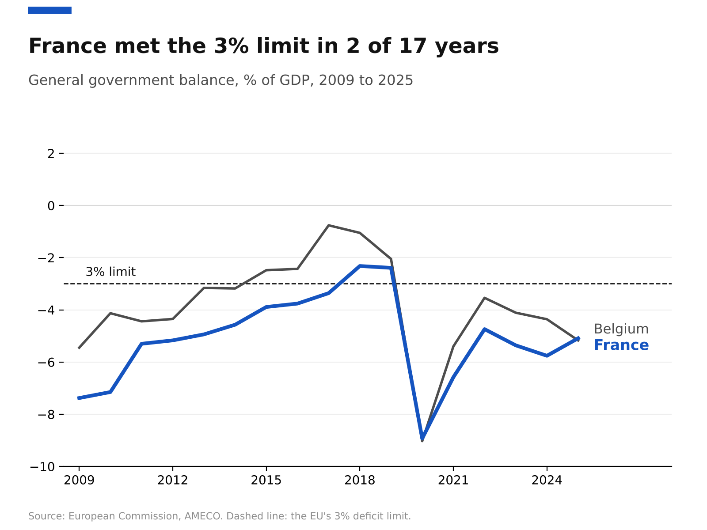
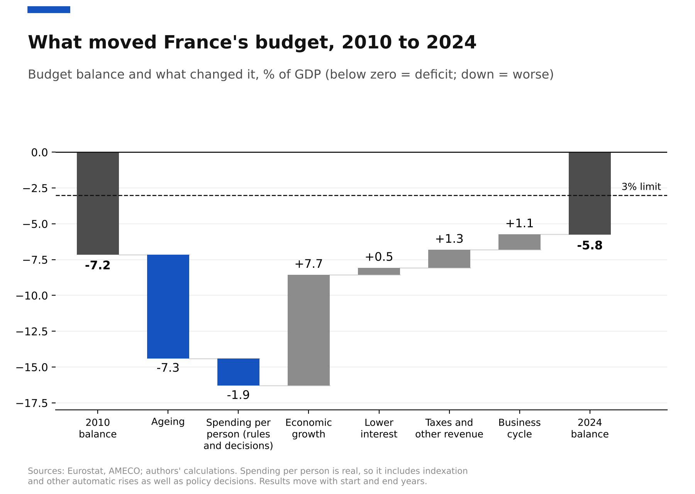
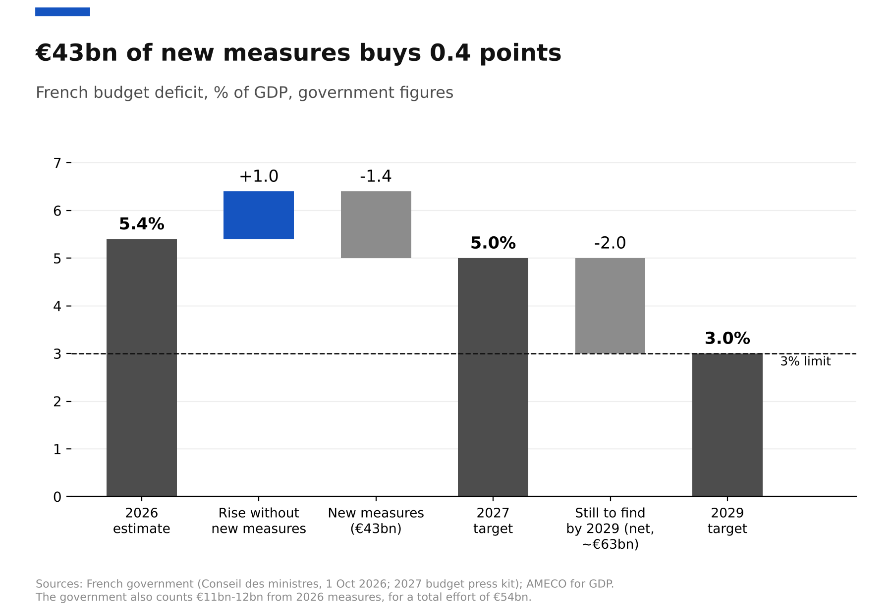

# Why France keeps missing 3%

*France's lower house has thrown out the revenue half of its 2027 budget. Since 2010 ageing has cost its budget about twice as much as Belgium's. Old-age spending has held at about 15% of GDP, yet the deficit has been above the EU's 3% limit in 15 of the past 17 years.*

On 4 November France's National Assembly rejected the revenue half of the 2027 budget by 458 votes to none. The spending half was never debated. The government's text now goes to the Senate, which votes on the whole bill on 9 December. If parliament has not decided by midnight on 17 December, the government may enact the budget by ordinance. No government of the Fifth Republic has done so.

This is not new. France has had five prime ministers since May 2022, and two of their governments fell over budgets, in December 2024 and September 2025. Since 2022 governments have used article 49.3 of the constitution about 30 times, almost all on budget texts. It adopts a bill without a vote unless the government is then censured.

The arithmetic under the politics has a twist. Between 2010 and 2024 ageing took about seven points of GDP off France's budget balance, roughly twice the bill in Belgium or the Netherlands. Yet public spending on old age and survivors, mostly pensions, stayed at about 15% of GDP. Spending per person aged 65 and over grew more slowly than GDP per head. France squeezed, and still missed the 3% limit in 15 of the past 17 years. It got under only in 2018 and 2019. Belgium, whose budget crisis we covered this week, missed it in 12 of those years, the Netherlands in five.

Our shorthand, as for Belgium, is a square peg in a round hole. In 2025 French government spending was 57% of GDP, against 49% for the EU as a whole. Since 2010 spending has ranged from 55% to 59% of GDP outside 2020 and 2021, and revenue from 51% to 54%. Spending has stayed above revenue every year. In 2025 the deficit was 5.1% of GDP and debt 116%.

France's two good years came after a long squeeze that took the deficit from 7.2% of GDP in 2010 to 2.4% in 2019. Covid ended it. So is this a run of bad luck, or something built into the budget? Three questions help answer it:

- What pushes the deficit up when nobody votes for it?
- What does this year's plan buy?
- Why do pensions keep coming back?

## What pushes the deficit up

Our breakdown of Eurostat and European Commission data, the same one we used for Belgium, shows what moved France's balance between 2010 and 2024. Ageing took 7.3 points of GDP off it: more people over 65 drawing pensions, and fewer people of working age to pay for all spending. Most French pensions count as public spending, so ageing lands on the budget.

Spending per person rose a little faster than prices and took 1.9 points. Growth in jobs and productivity gave back 7.7 points, taxes and other revenue 1.3, a stronger economic cycle 1.1 and cheaper debt 0.5. The net result: a deficit of 5.8% of GDP in 2024, against 7.2% in 2010. Measured against incomes rather than prices, spending per person improved the balance by about 7.5 points, more than in the Netherlands. Growth's share then shrinks to match. On either yardstick, ageing was the largest single drag.

## What this year's plan buys

The government calls its 2027 plan an effort of €54bn: €43bn of new measures, about 1.4% of GDP, and €11bn-12bn carried over from 2026 measures. Of the €43bn, it names €26.5bn of spending cuts across the state, social security and local government; most of the rest is revenue. It aims to cut the deficit from an estimated 5.4% of GDP in 2026 to 5.0% in 2027. The European Commission's latest forecast in our data, made before this plan, had 5.7% for 2027.

On the government's own figures, new measures worth 1.4 points of GDP buy a fall of 0.4. Without them, it says, the deficit would rise by about one point. Reaching 3% by 2029, as France has promised the EU, would take a further net fall of two points, about €63bn at 2027 prices.

Interest adds pressure. The European Commission expects France's interest bill to rise from 2.2% of GDP in 2025 to 2.8% in 2027.

## Pensions, again

Public spending on old age and survivors was 14.7% of GDP in 2024. That compares with about 12% in Belgium and Germany and 6% in the Netherlands, where occupational funds pay most pensions. The French share has hardly changed since 2010, while the share of over-65s in the population rose by almost 30%, from 17% to 22%. Many French pensioners are younger than 65, so this measure is per older person, not per pensioner.

Each budget round reopens the question. The 2023 reform raises the pension age from 62 to 64. Its suspension, announced in October 2025 as the government sought votes for its 2026 budget, became law in December. The age is frozen at 62 years and 9 months until January 2028. The government puts the cost at €0.4bn in 2026 and €1.8bn in 2027. The 2027 bill gives the full inflation rise only to pensions of up to €1,260 a month; above that, pensions rise by less. The saving is about €4bn. A Senate committee wants to raise the threshold to €1,500 and to drop the suspension.

## What to watch

The Senate votes on the social security budget on 18 November and on the state budget on 9 December. Three questions follow:

- Does the 2027 budget pass by a vote, by article 49.3 or by ordinance?
- Does the pension suspension survive the Senate and the presidential election of April and May 2027?
- Where would the further two points of GDP needed by 2029 come from?

---

**In numbers**

- **15 of 17**: years since 2009 in which France's deficit was above 3% of GDP; Belgium 12, the Netherlands 5.
- **7.3 points of GDP**: what ageing took off France's balance from 2010 to 2024; about twice Belgium's bill.
- **1.4 vs 0.4**: points of GDP of new measures planned for 2027, and the fall in the deficit they are meant to buy.
- **14.7%**: France's public spending on old age and survivors, mostly pensions, as a share of GDP in 2024.

**Check our work.** Data and code: [github.com/europeaudited/analysis](https://github.com/europeaudited/analysis/tree/main/2026-11-france-deficit). We split the change in the balance since 2010 into its parts with the method used for Belgium. Spending, revenue, pensions, deficits and interest are from Eurostat and the European Commission. Budget plans are the French government's (Conseil des ministres, 1 October 2026; 2027 budget press kit). Political facts are from Euronews, Public Sénat, LCP, vie-publique, Banque des Territoires and Reuters. Limits: one simple model; government figures are its own estimates against its own baseline.

*Produced with AI agents, checked by a human editor. Found an error? [Open a ticket](https://github.com/europeaudited/analysis/issues/new/choose) and we will correct it in public.*
