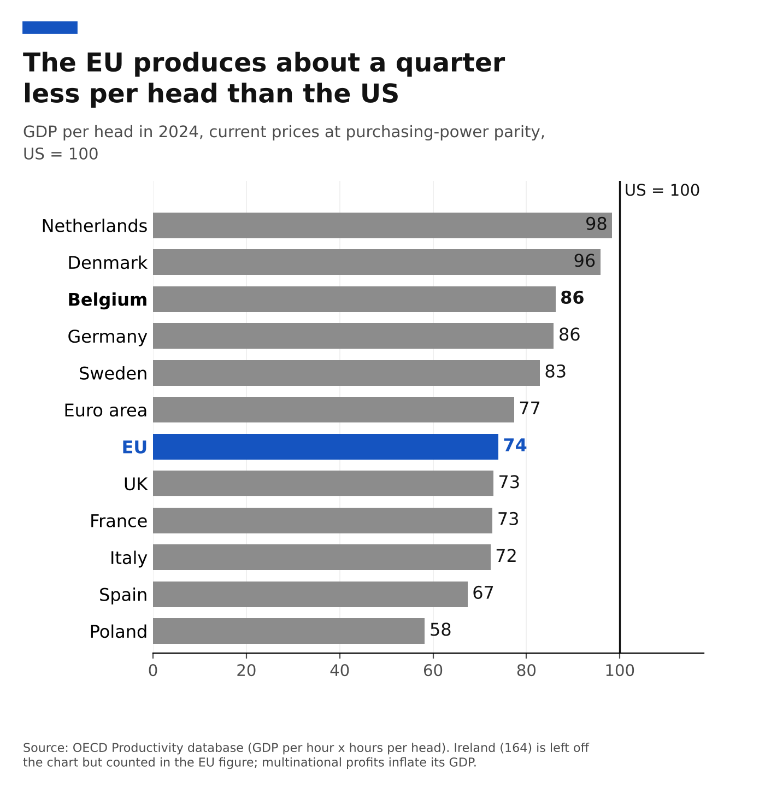

# The EU trails America by a quarter to a third

**The claim.** "Europeans are about 30% poorer than Americans."

**What we test.** Average output (GDP) and consumption per head, EU27 against the US. Not the median household.

**Verdict: Mostly true, on averages, for the EU.** The 30% sits inside the range the data give. It says nothing about who gets the money. High US health prices may inflate the consumption gap (not tested).

## What the data says

1. **The gap is 26% to 35%, depending on the measure.** EU output per head in 2024 is about USD 64,000 against USD 86,000 in the US, 26% lower (OECD). Eurostat: 28%. Consumption per head, which includes health and education paid by government, is 35% lower (2023).
2. **For the EU as a whole, the gap is mostly output per hour.** About two-thirds is lower output per hour, one-third fewer hours per head of population. Belgium is the reverse: output per hour is USD 109 against 100, but Belgians work a fifth fewer hours per head (682 against 860 a year), so output per head is 14% lower. Part is selection: 43% of Belgians are employed against 48.5% of Americans, so fewer lower-productivity workers are counted.
3. **The trend is not settled.** Real output per head grew about 4% in the EU from 2019 to 2024 and about 10% in the US (OECD, constant prices). In current-price comparisons the gap narrowed, from 30% to 26% since 2019 and from 36% since 2015, partly on price changes (not verified).

## The best case for the claim

Consumption, the broadest measure, gives 35%, above the claim. Belgium's consumption gap is 26% against 16% on output (Eurostat).

## What works instead

The Netherlands and Denmark close almost all the output gap (98 and 96, US = 100), and Denmark's output per hour is 12% above the US. On consumption they are still 22% and 29% below (Eurostat, 2023). In our view, Belgium's lever is more people in work, though extra workers would probably lower average output per hour.

## What would change the verdict

A median-household comparison with a much smaller gap, or a price-parity revision taking the EU gap below 20% or above 40%.

## Rerun this

Code, data and outputs: `analysis/`. Data: OECD Productivity database; Eurostat price-parity volume indices. Limits: averages only; price-parity errors of several points; Ireland is in the EU figure; 2024 data may be revised; fewer hours are partly choice and partly fewer people in work in Belgium, France and Italy, not the EU as a whole.

*Produced with AI agents and checked by a human editor.*
