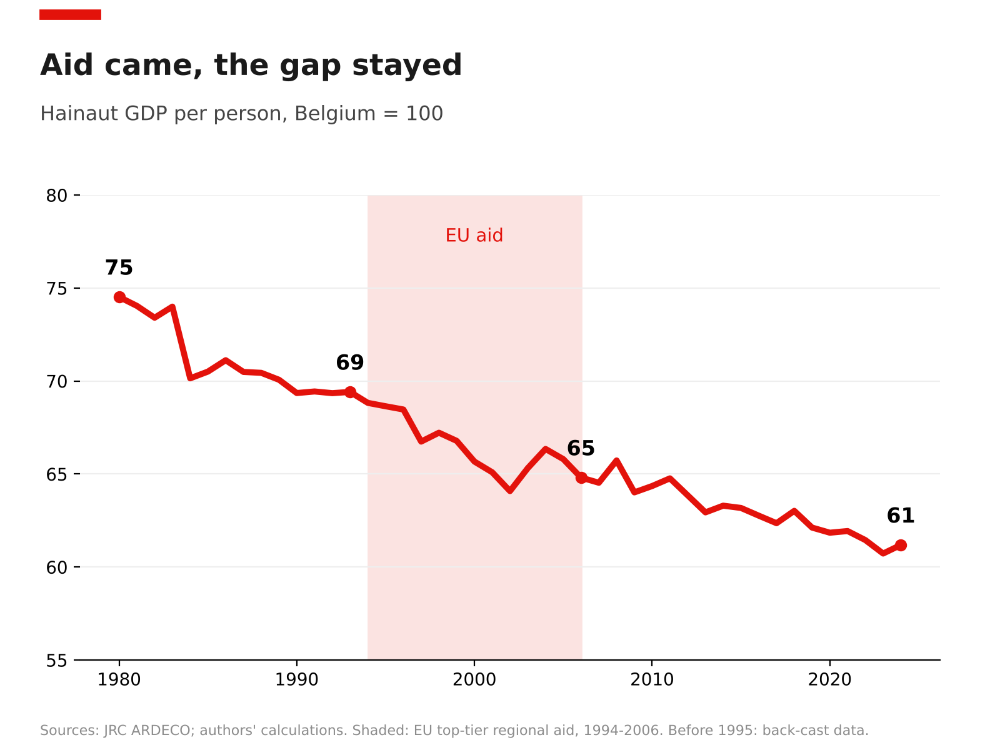

# Myth: "Subsidies and public spending drive growth"

**The claim.** "Public money pays for itself. Subsidies drive growth and local jobs."

**Verdict: Mixed.** Subsidies buy what they target. Evidence that they lift the wider economy is thin.



## What the data says

- **Targeted research aid works for research.** The partial payroll-tax exemption for researchers, about €1.6bn a year, raises firms' own research spending, according to Federal Planning Bureau evaluations. These studies measure research activity, not prosperity.
- **Much of the rest shows little.** Belgium spends about €25bn a year supporting business, over 4% of GDP and about 1.5 points more than its neighbours, according to the National Bank. Around two thirds is wage subsidies. The National Bank finds that cuts in employer contributions for first hires cost over €100,000 per extra job. The €2bn exemption for night and shift work comes with no evidence that it creates jobs.
- **Regional aid did not close the gap.** Hainaut got the EU's top tier of regional aid from 1994 to 2006. Its GDP per head was 74.5% of the Belgian level in 1980, 69% in 1993, 65% in 2006 and 61% today. The relative decline went on at about the same pace during the programme, and Hainaut added fewer jobs per head than its neighbours (1.8 points against 2.8 to 3.6). That rules out a large effect. It cannot show how much worse Hainaut would have done without the money, and the result changes with the comparison region.

## The best case for the claim

Much of Belgium's subsidy bill exists because labour taxes are among the highest in the world: the OECD puts the tax wedge on an average wage at 52.5%. Wage subsidies hand part of that back. They are part of the tax system, not extra spending. Cut them without cutting labour taxes and labour gets dearer.

Defenders also point out that service vouchers recover about 85% of their cost in Flanders, and that EU regional funds raised income growth in poor regions on average, by about 1.8 points a year. That gain fades once the money stops.

## What works instead

Pay for what has been measured. The researcher exemption and the Flemish service vouchers (net cost about €5,700 per full-time job) have evidence behind them. Beyond that, the choice is not "subsidies or no subsidies". It is dozens of targeted exemptions against one lower general labour tax. In our reading, the evaluations favour the general rate. That is a judgement, not a test result.

## Rerun this

```
pip install -r requirements.txt
python 2026-11-subsidies-myth/run.py
```

Method: we compare Hainaut's GDP and jobs per head with Liege, the rest of Wallonia, Flanders and Belgium, before, during and after the programme. Limits: one treated region, comparison regions that also received EU money, and pre-1995 data that are back-casts. Evidence table with sources: [evidence.md](evidence.md). Code, data and outputs: [README.md](README.md). Found a mistake? Open an issue with the "Something's wrong" form.

*Sources: National Bank of Belgium (2025), Federal Planning Bureau (Dumont), IWEPS (2019), Becker, Egger and von Ehrlich (2010, 2018), JRC ARDECO regional data, federal spending review 2026 (secondary).*
