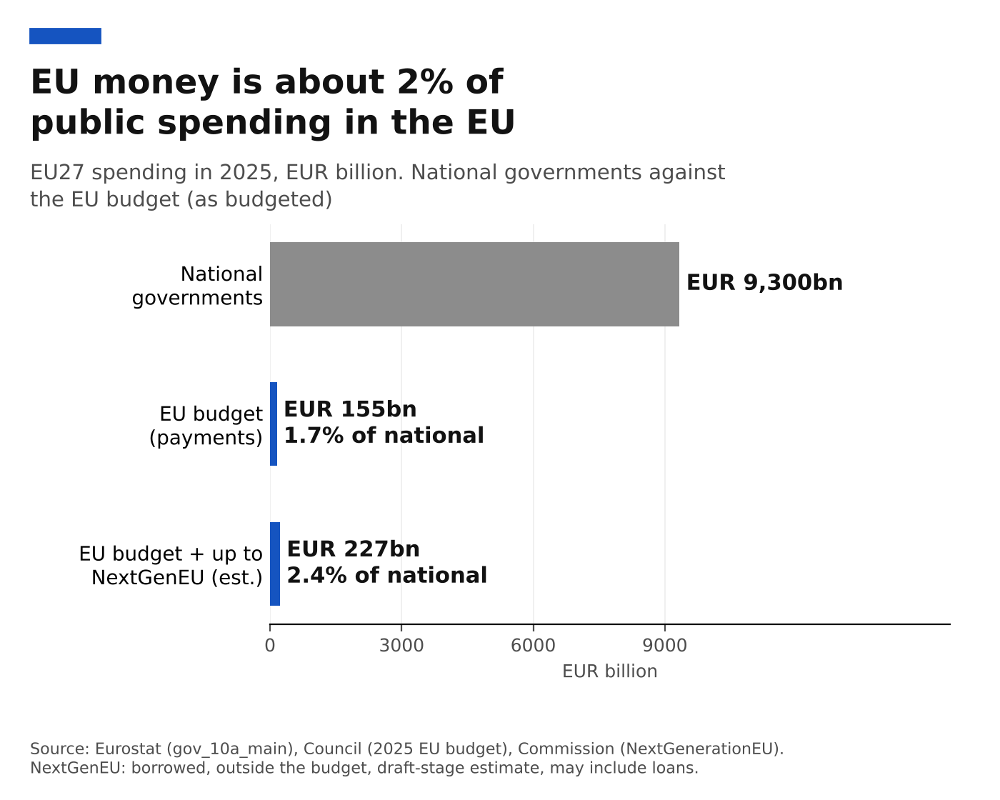

# The EU budget is small, not proven wasteful

**The claim.** "The EU budget is huge and wasteful."

**Verdict: Mostly false.** "Huge" is false. "Wasteful" is unproven: the auditors' warnings are real, but they measure broken rules, not value for money.

## What the data says

1. **Small next to national budgets.** The 2025 EU budget provides about EUR 155bn in payments (0.84% of gross national income) and about EUR 200bn in commitments (promises paid over years). National governments spend about EUR 9,300bn, near 49% of GDP. EU payments are about 1.7% of public spending: roughly EUR 340 a person a year, against EUR 20,700 nationally. Administration, including pensions and buildings, is about EUR 13bn, 8% of payments.
2. **Bigger on other bases.** On the auditors' 2024 spending base the share is 2.2%, or 2.8% with the recovery fund. NextGenerationEU, borrowed and outside the budget, adds up to about EUR 72bn in 2025 (an estimate that may include loans): up to about 2.4%. Figures are plans, not outturn. Still small.
3. **Error is not the same as waste.** The auditors estimate 3.6% of 2024 spending broke the rules, down from 5.6% in 2023. On their EUR 191bn base that is about EUR 7bn, our calculation. Most errors show no sign of fraud, but the auditors flagged 19 suspected cases in 812 sampled transactions. Whether the money bought value is not measured here.

## The best case for the claim

The auditors have given an adverse opinion on EU spending six years running. The 3.6% rate is 1.8 times their 2% threshold, error is 5.2% in rule-heavy spending, and over two thirds of audited spending carries a material risk of error. The recovery fund drew a qualified opinion. Its borrowing creates repayment and interest costs that a one-year comparison does not show. Against total spending the budget is small, but for investment in poorer member states it may be large. Cohesion funding delays were not tested.

## What works instead

No comparison on value for money is available here, so we name no better model. The rate fell from 5.6% to 3.6% in a year; we have not tested why. In our view, the useful debate is results per euro, not size.

## Rerun this

Code, data and outputs: `analysis/`. Sources: Council, 2025 EU budget infographic; Court of Auditors, annual report 2024 FAQ (Q1, Q7, Q8); Commission, 2025 draft budget page; Eurostat. Limits: budgeted, not outturn; Eurostat 2025 may be provisional; per-person uses 2024 population; overlap moves shares under 0.1 points.

*Produced with AI agents and checked by a human editor.*
