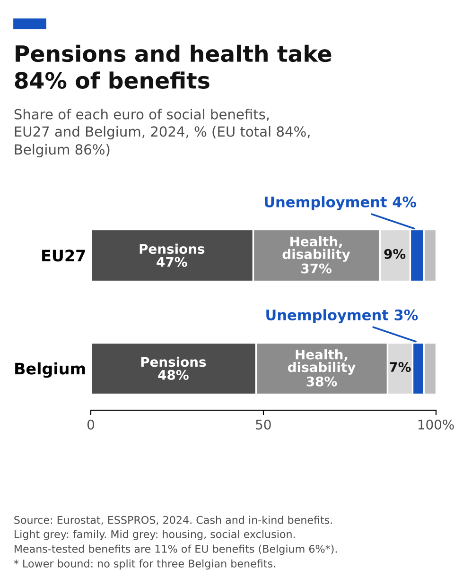

# Welfare mostly pays for old age and health, not unemployment

**The claim.** "Social spending mostly goes to the poor and the unemployed."

**Verdict: Mostly false.** Welfare mostly pays for old age and health: about 84% of benefits. Only about one euro in nine is means-tested, and about one in 25 is unemployment pay.

## What the data says

1. **Pensions and health take most of it.** In the EU, social benefits cost about 27% of GDP in 2024. Old age and survivors take 47% of each euro. Health care, sickness and disability take 37%. Family benefits take 9%. Belgium is similar: 48% and 38%.
2. **Unemployment is a small line.** It is about 4% of benefits in the EU, about 1% of GDP, and 3% in Belgium. Spain has the highest share, 6%.
3. **Income-tested aid is a minority.** About 11% of EU benefits are means-tested, meaning paid only below an income limit. Belgium shows 6%, a floor, because Eurostat gives no split for three of its big benefits. Denmark (36%) and Ireland (26%) are highest, which may partly reflect how countries classify schemes. Count every unemployment, housing and exclusion benefit and every means-tested benefit: about 14% of the total is aimed at jobless or low-income people by design.

## The best case for the claim

These numbers show purpose, not recipient income. We cannot measure how much of each benefit reaches the poorest. Pensions reach many poor people: counted as a transfer, they take EU poverty from about 43% to 24%. Other benefits take it to 16% (2025 survey). So spending that is not targeted still reaches the poor, mostly through pensions. That is why the verdict is not False. But pensioners overall are no poorer than others: 65+ poverty is 16.3%, the same as everyone, measured after pensions.

## What the research suggests

In our view, the useful question is how much poverty falls, not how much is targeted. A classic study argued that earnings-related benefits for all cut poverty and inequality more than tight targeting at the poor, or equal flat payments ([Korpi and Palme, 1998, American Sociological Review](https://econpapers.repec.org/RePEc:lis:liswps:174)). It compares Western countries with data from about the 1980s and shows a correlation, not proof of cause. It has been debated, and it is dated.

## Rerun this

Code, data and outputs: `analysis/`. Data: Eurostat ESSPROS, 2024 (2025 is an early estimate and does not change the message). Shares are of all benefits, cash and in kind. Limits: Belgium's means-tested share is a lower bound, definitions differ by country, and "means-tested" is not the same as "poor".

*Produced with AI agents and checked by a human editor.*
